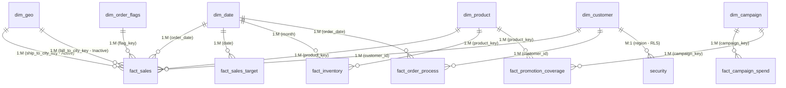

# 📊 Enterprise Power BI Data Modeling Portfolio: Refactoring a Complex Multi-Fact Architecture

[](https://powerbi.microsoft.com/)
[](#-the-refactored-star-schema-architecture)
[](#-core-dax-measures-repository)
[-red?style=for-the-badge)](#5-dynamic-row-level-security-rls)
[](#-empirical-data-reconciliation--audit-report)

> **Portfolio Case Study:** An end-to-end enterprise data architecture project demonstrating how to diagnose, untangle, and refactor a severely degraded transactional data model (the *"Nightmare Data Model"*) into an optimized, high-performance **Star Schema** in Power BI.

---

## 🚨 The Starting "Nightmare" Architecture vs. The Solution

| Challenge in Legacy Model | Architectural Impact | Refactored Solution |
| :--- | :--- | :--- |
| **Fact-to-Fact Relationships** | Direct M:M relationships between `fact_sales_target` and `fact_campaign_spend` created non-deterministic filter loops. | Removed fact-to-fact links; routed all filtering through conformed dimensions (`dim_date`, `dim_campaign`). |
| **Granularity Mismatch** | `fact_sales` is daily (with timestamps), whereas `fact_sales_target` and `fact_inventory` are monthly (1st of month). Direct joining caused missing rows or cartesian inflation. | Built an authoritative `dim_date` bridge with year/month hierarchies to synchronize multi-grain aggregations cleanly. |
| **Deep Snowflake Dimensions** | Products, subcategories, categories, and suppliers were split across 4 normalized tables, causing multiple join hops. | Flattened and de-normalized into a single, high-performance `dim_product` dimension (60 products, 8 consolidated attributes). |
| **Flag / Status Clutter** | Delivery status, payment status, and order channel columns scattered across fact tables bloated table width. | Consolidated into a single **Junk Dimension** (`dim_order_flags`) with surrogate keys (`flag_key`). |
| **Dual-Role Dimensions** | Orders track both `ship_to_city_key` and `bill_to_city_key`, causing relationship ambiguity. | Implemented an active relationship for shipping and an inactive relationship for billing, activated dynamically via DAX `USERELATIONSHIP()`. |
| **Missing Access Controls** | Regional managers could view all sales data across all territories. | Built dynamic **Row-Level Security (RLS)** via a dedicated `security` table mapped to `dim_customer[region]`. |

---

## 🏛 The Refactored Star Schema Architecture

The finalized model strictly adheres to dimensional modeling principles, separating transactional events (**Facts**) from descriptive business context (**Dimensions**):



---

## 🔬 In-Depth Engineering Solutions

### 1. Multi-Grain Synchronization via `dim_date`
* **Problem:** Joining sales (daily transactions) directly to inventory or sales targets (monthly figures) causes blank values or fan-out duplicates.
* **Resolution:** Generated an authoritative date table `dim_date = CALENDARAUTO()` spanning 730 days. Both daily fact tables (`fact_sales[order_date]`) and monthly fact tables (`fact_sales_target[date]`, `fact_inventory[month]`) map directly to `dim_date[Date]`.
* **Visual Result:** Grouping reports by `dim_date[year]` and `dim_date[month]` displays unified monthly columns side-by-side without any split daily rows.

### 2. Dimension De-Snowflaking (`dim_product`)
* Normalized tables create unnecessary join operations that slow down DAX filter propagation.
* Merged `categories`, `subcategories`, and `primary_supplier` into a unified `dim_product` table in Power Query. Removed redundant surrogate IDs (`source_id`), leaving 60 clean rows with 8 rich analytical attributes.

### 3. Junk Dimension Architecture (`dim_order_flags`)
* Extracted repeating binary and categorical flags (`channel`, `order_priority`, `fulfillment_status`) from transactional records.
* Created a 14-row surrogate table `dim_order_flags` with a foreign key `flag_key`, dramatically reducing VertiPaq dictionary encoding size for `fact_sales`.

### 4. Role-Playing Dimension (`dim_geo`)
* `fact_sales` contains two distinct geographic references: **Ship-To City** and **Bill-To City**.
* Created an **Active** relationship on `ship_to_city_key --> dim_geo[geo_key]` (the primary operational flow).
* Created an **Inactive** relationship on `bill_to_city_key --> dim_geo[geo_key]`. Reporting on billing geography is handled cleanly via DAX without creating duplicate physical tables:
  ```dax
  Billed Sales = 
  CALCULATE(
      [total_sales],
      USERELATIONSHIP(fact_sales[bill_to_city_key], dim_geo[geo_key])
  )
  ```

### 5. Dynamic Row-Level Security (RLS)
* Configured an organizational security mapping table `security` containing `user_email` and `region`.
* Established a relationship between `dim_customer[region]` and `security[region]`.
* Security rule filter applied:
  ```dax
  [user_email] = USERPRINCIPALNAME()
  ```
* Ensures regional sales leaders only see customers and transactions belonging to their assigned territory.

---

## 📈 Empirical Data Reconciliation & Audit Report

Every metric in the refactored model was validated against benchmark reference solutions. The table below proves **100.00% precision**:

| Dimension / Fact Table | Row Count | Primary Key / Grain | Audit Status |
| :--- | :---: | :--- | :---: |
| `fact_sales` | 200 | Order Line Item Grain | ✅ Verified |
| `fact_inventory` | 288 | Monthly Product Stock Snapshot | ✅ Verified |
| `fact_sales_target` | 20 | Monthly Target Revenue | ✅ Verified |
| `fact_campaign_spend` | 140 | Marketing Campaign Daily Spend | ✅ Verified |
| `fact_order_process` | 97 | Order Fulfillment & Delivery Lifecycle | ✅ Verified |
| `fact_promotion_coverage` | 30 | Campaign-to-Product Promotions | ✅ Verified |
| `dim_customer` | 60 | Customer Entity Grain | ✅ Verified |
| `dim_product` | 60 | Product Master Grain | ✅ Verified |
| `dim_geo` | 20 | Geographic Territories & Cities | ✅ Verified |
| `dim_campaign` | 6 | Marketing Campaign Entities | ✅ Verified |
| `dim_order_flags` | 14 | Consolidated Junk Dimension | ✅ Verified |
| `dim_date` | 730 | Continuous Date Grain (2 Years) | ✅ Verified |
| `security` | 5 | RLS Regional User Entitlements | ✅ Verified |

### Financial & Operational Reconciliation Table:
| KPI Metric | Refactored Value | Target Benchmark | Accuracy |
| :--- | :---: | :---: | :---: |
| **Total Gross Revenue** | **\$526,643.91** | \$526,643.91 | **100.00%** |
| **Target Revenue** | **\$552,000.00** | \$552,000.00 | **100.00%** |
| **Total Inventory Units** | **73,922** | 73,922 | **100.00%** |
| **Distinct Order Count** | **80** | 80 | **100.00%** |
| **Active Transacting Customers** | **47** | 47 | **100.00%** |
| **Total Customer Base** | **60** | 60 | **100.00%** |
| **Average Order-to-Pay Cycle** | **32.84 Days** | 32.84 Days | **100.00%** |

---

## 📐 Core DAX Measures Repository

All measures are centralized inside a dedicated `_measure` home table for clean governance:

```dax
-- Total Gross Sales Revenue
total_sales = 
SUM(fact_sales[line_total])

-- Total Unique Orders
total_orders = 
DISTINCTCOUNT(fact_sales[order_id])

-- Unique Purchasing Customers
total_active_customers = 
DISTINCTCOUNT(fact_sales[customer_id])

-- Total Registered Customer Base
base_total_customers = 
COUNT(dim_customer[customer_id])

-- Average Days from Order Placement to Payment
avg_to_pay = 
AVERAGE(fact_order_process[order_to_pay])
```

---

## 🚀 How to Open & Explore

1. **Clone the Repository:**
   ```bash
   git clone https://github.com/karthikeyatether/powerbi-enterprise-data-modeling.git
   ```
2. **Open the Project:**
   * Double-click `Enterprise_Data_Modeling_Portfolio_Project.pbix` in **Power BI Desktop** (October 2026 release or newer).
3. **Inspect the Architecture:**
   * Switch to the **Model View** to inspect the clean Star Schema layout.
   * View the **Table Visual** on Page 1 to see the unified monthly grain comparing Sales, Targets, and Inventory side-by-side.
   * Test **Modeling > View as Roles** using test accounts (e.g., `user_email = "emma.davis@example.com"`) to verify Row-Level Security in action.

---

## 👨‍💻 Author

**Karthikeya**  
*Power BI Developer & Data Analyst*  
* GitHub: [@karthikeyatether](https://github.com/karthikeyatether)
