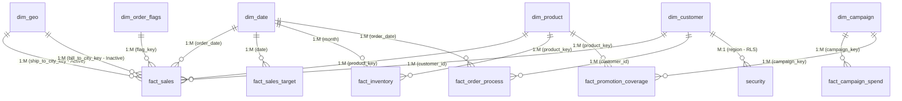

# Power BI Data Modeling Portfolio: Retail Star Schema Project

[](https://powerbi.microsoft.com/)
[](#-the-data-model)
[](#-key-dax-measures)
[](#6-row-level-security-rls)

A practical portfolio project demonstrating how to take a messy, relational retail dataset and rebuild it into a clean, working **Star Schema** in Power BI.

---

## 📌 Project Overview

When building reports in Power BI, data rarely comes in clean star schemas. In this project, I worked with a retail dataset spread across multiple transactional tables (sales, inventory, sales targets, fulfillment, campaigns). 

The initial model had several common real-world problems:
* Direct links between fact tables (causing relationship loops and broken totals).
* Daily sales data mixed with monthly targets and inventory snapshots (causing missing rows in reports).
* Product details scattered across 4 different tables.
* Multiple city columns (shipping vs. billing) causing ambiguity.

I used **Power Query** and **DAX** to clean, restructure, and model the data into an organized Star Schema where every measure calculates accurately.

---

## 🛠 Problems I Solved

### 1. Mismatched Dates (Daily Sales vs. Monthly Targets & Inventory)
* **The Problem:** `fact_sales` records orders daily, but `fact_sales_target` and `fact_inventory` only have data on the 1st of every month. Joining them directly caused sales numbers to show up on blank rows or separate daily rows.
* **The Solution:** Created a continuous 2-year calendar table (`dim_date = CALENDARAUTO()`) covering 2025–2026 (730 days). Connected all fact tables to this central date table. Now reports can group by Year and Month to compare Sales, Targets, and Inventory side-by-side cleanly.

### 2. Fact-to-Fact Links (Relationship Loops)
* **The Problem:** Marketing spend and sales targets were connected directly to each other, creating confusing many-to-many paths.
* **The Solution:** Removed direct fact-to-fact relationships. All tables now filter through shared dimension tables (`dim_date` and `dim_campaign`), creating clear, one-way filter paths.

### 3. De-Snowflaking Product Tables
* **The Problem:** Product data was split across four separate tables (products, subcategories, categories, suppliers), requiring multiple join hops.
* **The Solution:** In Power Query, merged these into a single clean `dim_product` table (60 unique products with category, supplier, and price attributes).

### 4. Creating a Junk Dimension (`dim_order_flags`)
* **The Problem:** Low-cardinality status text (channel, delivery status, order priority) was repeated across every single row in the sales table.
* **The Solution:** Combined these flags into a separate 14-row lookup table (`dim_order_flags`) with a simple key (`flag_key`), keeping the main sales table lean.

### 5. Handling Two Cities on One Order (Role-Playing Dimension)
* **The Problem:** Each order has a **Ship-To City** and a **Bill-To City**, but Power BI cannot have two active relationships between the same two tables.
* **The Solution:** Kept `ship_to_city_key` as the active relationship, and made `bill_to_city_key` inactive. Used DAX `USERELATIONSHIP()` when reporting specifically on billing revenue:
  ```dax
  Billed Sales = 
  CALCULATE(
      [total_sales],
      USERELATIONSHIP(fact_sales[bill_to_city_key], dim_geo[geo_key])
  )
  ```

### 6. Row-Level Security (RLS)
* **The Problem:** Regional managers should only see customers and sales in their own territory.
* **The Solution:** Linked a `security` table to `dim_customer` by region. Applied a dynamic security rule so Power BI automatically filters data based on the logged-in user:
  ```dax
  [user_email] = USERPRINCIPALNAME()
  ```

---

## 🏛 The Data Model

Here is the clean Star Schema structure:



---

## 📊 Summary Numbers & Verification

To verify the model is working accurately, key totals reconcile across all tables:

| Metric | Total Value | Note |
| :--- | :---: | :--- |
| **Total Gross Sales** | **$526,643.91** | Sum of 200 sales line items |
| **Total Sales Target** | **$552,000.00** | 20 monthly target periods |
| **Total Inventory Stocked** | **73,922 units** | 288 monthly inventory snapshots |
| **Total Unique Orders** | **80 orders** | Distinct order count |
| **Active Purchasing Customers** | **47 customers** | Out of 60 registered customers |
| **Avg Days Order-to-Pay** | **32.84 days** | Fulfillment cycle duration |

---

## 📐 Key DAX Measures

Measures are organized in a dedicated `_measure` table:

```dax
-- Total Gross Sales
total_sales = 
SUM(fact_sales[line_total])

-- Total Orders
total_orders = 
DISTINCTCOUNT(fact_sales[order_id])

-- Active Customers
total_active_customers = 
DISTINCTCOUNT(fact_sales[customer_id])

-- Customer Base
base_total_customers = 
COUNT(dim_customer[customer_id])

-- Average Days to Payment
avg_to_pay = 
AVERAGE(fact_order_process[order_to_pay])
```

---

## 🚀 How to Run the Project

1. Clone or download this repository.
2. Open `Enterprise_Data_Modeling_Portfolio_Project.pbix` in **Power BI Desktop**.
3. Go to the **Model View** tab to inspect the relationships and table layouts.
4. Check **Page 1** in Report View to see the monthly comparison table and KPI cards in action.

---

## 👤 Author

**Karthikeya Kolukuri**  
*Power BI & Data Analyst*  
* GitHub: [@karthikeyatether](https://github.com/karthikeyatether)  
* Portfolio: [karthikeyatether.github.io](https://karthikeyatether.github.io/)
